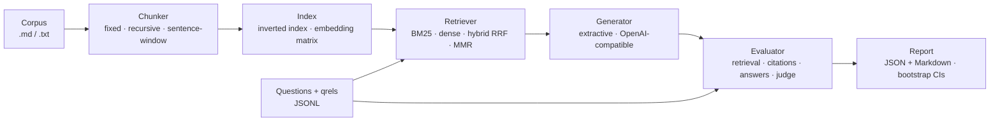

# py-rag-eval

[](https://github.com/bhavana-sanal/py-rag-eval/actions/workflows/ci.yml)
[](LICENSE)


**Build, measure and compare retrieval-augmented generation pipelines with reproducible, offline-first experiments.**

## Why evaluate RAG?

A RAG system has many knobs: how documents are chunked, which retriever ranks them, how many chunks go into the prompt, which model writes the answer. Each one changes quality, and changes interact: a chunker that helps BM25 can hurt a dense retriever, and a larger `k` raises recall while burying the useful passage among distractors. Picking settings by eyeballing a handful of answers is how regressions ship.

`py-rag-eval` treats a RAG pipeline like any other system under test. You describe a grid of configurations in TOML, run them against a labelled question set, and get per-question scores, aggregate metrics with bootstrap confidence intervals, and a paired significance test for any two configurations. Everything runs offline by default, so the same experiment works in CI, on a laptop without a GPU, or against a local or hosted LLM when you want real generations.

## Features

- **Ingestion** of Markdown and plain-text corpora, with labelled questions in JSONL (binary or graded relevance).
- **Chunkers**: fixed-size sliding window with overlap, recursive (headings → paragraphs → sentences → words), and sentence-window (index one sentence, give the generator its neighbours).
- **Retrievers**: BM25 (own implementation over an inverted index), dense cosine search over a NumPy matrix, hybrid via Reciprocal Rank Fusion, MMR diversification, and a `Reranker` protocol to plug in a cross-encoder or anything else.
- **Embedders**: a deterministic TF-IDF + SVD (LSA) embedder that needs no downloads, or any `sentence-transformers` model via the optional `[embeddings]` extra.
- **Generators**: any OpenAI-compatible `/chat/completions` endpoint (OpenAI, Ollama, vLLM, llama.cpp) with a numbered-citation prompt, plus a deterministic extractive generator for tests and baselines.
- **Metrics**: Hit@k, Recall@k, MRR, nDCG@k; citation precision and recall; token F1 and exact match against reference answers; optional LLM-as-judge faithfulness and relevance with pydantic-validated JSON verdicts and an on-disk cache.
- **Statistics**: percentile bootstrap confidence intervals for every metric, and paired comparison of two runs (bootstrap CI on the difference plus a sign-flip permutation test).
- **Experiments as config**: TOML grids over chunker × retriever × k, strict validation (typos fail loudly), JSON results and a Markdown report.
- **Small footprint**: the core depends only on `numpy`, `httpx` and `pydantic`; the CLI uses the standard library.

## Architecture



Each stage is a small protocol with interchangeable implementations:

| Module | Responsibility |
|---|---|
| `ingest.py` | Load documents and labelled questions |
| `chunking.py` | `FixedSizeChunker`, `RecursiveChunker`, `SentenceWindowChunker` |
| `embeddings.py` | `LsaEmbedder`, `SentenceTransformerEmbedder` |
| `retrievers/` | `BM25Retriever`, `DenseRetriever`, `HybridRetriever` (RRF), `RerankedRetriever` + `MMRReranker` |
| `llm.py`, `generation.py` | OpenAI-compatible client, citation prompt, `LLMGenerator`, `ExtractiveGenerator` |
| `judge.py` | Rubric prompt, verdict validation, on-disk cache |
| `metrics.py`, `stats.py` | Pure metric functions, bootstrap and permutation statistics |
| `config.py`, `pipeline.py`, `runner.py` | TOML schema and grid expansion, component builders, experiment loop |
| `results.py`, `report.py`, `cli.py` | Result models, paired comparison, Markdown rendering, CLI |

## Quickstart

```bash
git clone https://github.com/bhavana-sanal/py-rag-eval.git
cd py-rag-eval
uv sync                       # or: python -m venv .venv && .venv/bin/pip install -e .
uv run rag-eval run experiments/example.toml
```

This runs 24 configurations over the bundled demo set in a couple of seconds, prints the report, and writes `results/example.json` and `results/example.md`.

The building blocks are also usable directly from Python:

```python
from pathlib import Path

from rag_eval import (
    BM25Retriever,
    DenseRetriever,
    ExtractiveGenerator,
    HybridRetriever,
    LsaEmbedder,
    RecursiveChunker,
)
from rag_eval.chunking import chunk_corpus
from rag_eval.ingest import load_corpus

docs = load_corpus(Path("data/demo/corpus"))
chunks = chunk_corpus(RecursiveChunker(max_words=150), docs)

retriever = HybridRetriever([BM25Retriever(), DenseRetriever(LsaEmbedder(dim=128))])
retriever.index(chunks)

question = "How long are dead jobs kept?"
hits = retriever.retrieve(question, k=3)
print([hit.chunk.id for hit in hits])
# ['dead-letter#0', 'retention-and-backups#0', 'metrics#0']
print(ExtractiveGenerator().generate(question, [hit.chunk for hit in hits]).text)
# By default succeeded and cancelled jobs are kept for 7 days and dead jobs for 14 days. [2]
```

## CLI usage

```text
rag-eval run CONFIG.toml [--out DIR]
    Run every point of the experiment grid. Writes DIR/<name>.json (summary and
    per-question scores) and DIR/<name>.md (report table). DIR defaults to results/.

rag-eval compare A.json B.json [--run-a ID] [--run-b ID] [--resamples N] [--seed S]
    Paired comparison of two runs on the questions they share. A and B may be the
    same file; --run-a/--run-b pick a run when a file holds several.
```

Example, comparing two runs from the same experiment:

```bash
rag-eval compare results/example.json results/example.json \
  --run-a sentence/dense/k=3 --run-b recursive/bm25/k=5
```

```text
**A** = `sentence/dense/k=3`
**B** = `recursive/bm25/k=5`

| Metric | n | A | B | Δ (B - A) | 95% CI of Δ | p |
|---|---:|---:|---:|---:|---:|---:|
| Hit@k | 43 | 0.837 | 0.953 | +0.116 | [+0.000, +0.233] | 0.127 |
| Recall@k | 43 | 0.779 | 0.895 | +0.116 | [+0.000, +0.233] | 0.091 |
| MRR | 43 | 0.729 | 0.835 | +0.107 | [+0.025, +0.196] | 0.024 |
| nDCG@k | 43 | 0.718 | 0.822 | +0.104 | [+0.020, +0.193] | 0.024 |
| Cite P | 43 | 0.674 | 0.744 | +0.070 | [-0.023, +0.163] | 0.372 |
| Cite R | 43 | 0.570 | 0.651 | +0.081 | [+0.000, +0.174] | 0.125 |
| F1 | 43 | 0.165 | 0.170 | +0.004 | [-0.024, +0.033] | 0.778 |
| EM | 43 | 0.000 | 0.000 | +0.000 | [+0.000, +0.000] | 1.000 |

Δ CI from a paired bootstrap; p from a two-sided sign-flip permutation test.
```

## Experiment configuration

Experiments are TOML files (parsed with the standard library's `tomllib`). Relative paths resolve against the config file. Unknown keys are rejected. See [`experiments/example.toml`](experiments/example.toml) for a complete file.

```toml
name = "example"                            # used for output file names
corpus = "../data/demo/corpus"              # directory of .md / .txt files
questions = "../data/demo/questions.jsonl"
bootstrap_resamples = 2000                  # default 2000
seed = 0                                    # default 0

[grid]                                      # every combination is one run
chunker = ["fixed", "recursive"]            # names of [chunkers.*] tables
retriever = ["bm25", "hybrid"]              # names of [retrievers.*] tables
k = [3, 5]                                  # chunks retrieved per question

[chunkers.fixed]
type = "fixed"                              # size = 200, overlap = 40 (words)

[chunkers.recursive]
type = "recursive"                          # max_words = 200

# [chunkers.sentence]
# type = "sentence_window"                  # window = 1 (sentences on each side)

[retrievers.bm25]
type = "bm25"                               # k1 = 1.5, b = 0.75

[retrievers.dense]
type = "dense"                              # uses [embedder]

[retrievers.hybrid]
type = "hybrid"
members = ["bm25", "dense"]                 # two or more non-hybrid retrievers
rrf_k = 60                                  # RRF constant; depth = 50 candidates per member
mmr_lambda = 0.7                            # any retriever: enable MMR (omit to disable)
mmr_fetch_k = 20                            # candidates MMR chooses from

[embedder]
type = "lsa"                                # dim = 128
# type = "sentence-transformers"            # model = "all-MiniLM-L6-v2"

[generator]
type = "extractive"                         # default
# type = "openai"                           # any OpenAI-compatible endpoint
# model = "llama3.3"
# base_url = "http://localhost:11434/v1"    # default: $OPENAI_BASE_URL, then api.openai.com
# api_key_env = "OPENAI_API_KEY"            # name of the env var holding the key
# temperature = 0.0
# timeout = 60

# [judge]                                   # optional; omit to skip judge metrics
# model = "gpt-5-mini"
# base_url, api_key_env, timeout as above
# cache_dir = ".rag-eval-cache"
```

Questions are JSON lines. `relevant` is a list of document ids (grade 1) or a map of id to graded relevance; `answer` is optional and enables F1/EM:

```json
{"id": "q17", "question": "How long are dead jobs kept?", "relevant": ["dead-letter", "retention-and-backups"], "answer": "14 days"}
```

Document ids are file paths relative to the corpus directory without the extension.

### Running against a real model

With [Ollama](https://ollama.com) running locally:

```toml
[generator]
type = "openai"
model = "llama3.3"
base_url = "http://localhost:11434/v1"
```

For a hosted API, set `OPENAI_API_KEY` (or the variable named by `api_key_env`) and choose a model such as `gpt-5-mini`. Adding a `[judge]` table enables faithfulness and relevance scores; judge verdicts are cached by a hash of model and prompt, so re-running an experiment only pays for new answers.

## Metrics

Retrieval metrics are computed at the **document** level. The `k` retrieved chunks are mapped to their source documents and de-duplicated in rank order, giving a ranked list $D_k$ of at most $k$ documents. $R$ is the set of relevant documents for the question. Every metric is averaged over questions.

| Metric | Definition |
|---|---|
| Hit@k | $1$ if $D_k \cap R \neq \emptyset$, else $0$ |
| Recall@k | $\lvert D_k \cap R\rvert \,/\, \lvert R\rvert$ |
| MRR | $1/\text{rank}$ of the first relevant document in $D_k$, $0$ if none |
| nDCG@k | $\text{DCG}/\text{IDCG}$ with $\text{DCG} = \sum_i g_i / \log_2(i+1)$, $g_i$ the relevance grade at rank $i$, IDCG the DCG of the ideal ordering |
| Citation precision | Fraction of citation markers `[n]` in the answer that point at a passage from a relevant document. Markers that match no passage count as wrong; an answer without citations scores 0 |
| Citation recall | Fraction of relevant documents cited at least once |
| Token F1 | Harmonic mean of token precision and recall between answer and reference after SQuAD normalisation (lowercase, strip punctuation and articles) |
| Exact match | $1$ if the normalised answer equals the normalised reference |
| Faithfulness | Judge score 1–5 for "every claim is supported by the retrieved context", rescaled to $(s-1)/4$ |
| Relevance | Judge score 1–5 for "the answer addresses the question", rescaled to $(s-1)/4$ |

**Confidence intervals** are 95% percentile bootstrap intervals over questions (2,000 resamples by default).
**Paired comparison** pairs two runs by question id and reports the mean difference $\bar{d} = \overline{b - a}$ with a paired-bootstrap CI and a two-sided p-value from a sign-flip permutation test: under the null hypothesis each per-question difference is equally likely to be positive or negative, and $p = (1 + \#\{\lvert\bar{d}^{*}\rvert \ge \lvert\bar{d}\rvert\}) / (1 + N)$.

## Example results

Produced by `rag-eval run experiments/example.toml` with the **offline LSA embedder and the extractive generator** on the bundled demo set. These numbers describe this small synthetic benchmark only; they are not a claim about the retrievers in general.

| Run | Chunks | Hit@k | Recall@k | MRR | nDCG@k | nDCG@k 95% CI | Cite P | Cite R | F1 | F1 95% CI | EM |
|---|---:|---:|---:|---:|---:|---:|---:|---:|---:|---:|---:|
| `fixed/bm25/k=3` | 52 | 0.884 | 0.802 | 0.810 | 0.774 | [0.66, 0.87] | 0.698 | 0.605 | 0.147 | [0.10, 0.20] | 0.000 |
| `fixed/bm25/k=5` | 52 | 0.953 | 0.884 | 0.828 | 0.812 | [0.72, 0.89] | 0.721 | 0.616 | 0.146 | [0.10, 0.20] | 0.000 |
| `fixed/dense/k=3` | 52 | 0.930 | 0.837 | 0.818 | 0.788 | [0.69, 0.87] | 0.721 | 0.616 | 0.144 | [0.10, 0.20] | 0.000 |
| `fixed/dense/k=5` | 52 | 0.953 | 0.872 | 0.824 | 0.804 | [0.72, 0.88] | 0.721 | 0.616 | 0.144 | [0.10, 0.20] | 0.000 |
| `fixed/hybrid/k=3` | 52 | 0.907 | 0.814 | 0.822 | 0.784 | [0.68, 0.87] | 0.721 | 0.616 | 0.146 | [0.10, 0.20] | 0.000 |
| `fixed/hybrid/k=5` | 52 | 0.953 | 0.884 | 0.832 | 0.815 | [0.73, 0.89] | 0.721 | 0.616 | 0.146 | [0.10, 0.20] | 0.000 |
| `fixed/hybrid-mmr/k=3` | 52 | 0.930 | 0.837 | 0.814 | 0.786 | [0.69, 0.87] | 0.721 | 0.616 | 0.144 | [0.10, 0.20] | 0.000 |
| `fixed/hybrid-mmr/k=5` | 52 | **0.977** | **0.895** | 0.824 | 0.811 | [0.73, 0.88] | 0.721 | 0.616 | 0.144 | [0.10, 0.20] | 0.000 |
| `recursive/bm25/k=3` | 52 | 0.884 | 0.802 | 0.818 | 0.781 | [0.68, 0.87] | **0.744** | **0.651** | 0.170 | [0.12, 0.22] | 0.000 |
| `recursive/bm25/k=5` | 52 | 0.953 | **0.895** | 0.835 | **0.822** | [0.73, 0.90] | **0.744** | **0.651** | 0.170 | [0.12, 0.22] | 0.000 |
| `recursive/dense/k=3` | 52 | 0.860 | 0.767 | 0.806 | 0.756 | [0.64, 0.85] | **0.744** | 0.640 | 0.168 | [0.12, 0.22] | 0.000 |
| `recursive/dense/k=5` | 52 | 0.953 | 0.884 | 0.828 | 0.807 | [0.72, 0.89] | **0.744** | 0.640 | 0.169 | [0.12, 0.23] | 0.000 |
| `recursive/hybrid/k=3` | 52 | 0.884 | 0.802 | 0.829 | 0.790 | [0.68, 0.88] | **0.744** | **0.651** | 0.170 | [0.12, 0.22] | 0.000 |
| `recursive/hybrid/k=5` | 52 | 0.930 | 0.860 | **0.841** | 0.815 | [0.72, 0.90] | **0.744** | **0.651** | 0.170 | [0.12, 0.22] | 0.000 |
| `recursive/hybrid-mmr/k=3` | 52 | 0.860 | 0.767 | 0.806 | 0.756 | [0.64, 0.85] | **0.744** | 0.640 | 0.168 | [0.12, 0.22] | 0.000 |
| `recursive/hybrid-mmr/k=5` | 52 | 0.953 | 0.884 | 0.827 | 0.806 | [0.72, 0.88] | **0.744** | 0.640 | 0.169 | [0.12, 0.23] | 0.000 |
| `sentence/bm25/k=3` | 378 | 0.907 | 0.849 | 0.791 | 0.785 | [0.68, 0.87] | 0.698 | 0.593 | **0.174** | [0.12, 0.23] | 0.000 |
| `sentence/bm25/k=5` | 378 | 0.930 | 0.884 | 0.797 | 0.801 | [0.71, 0.88] | 0.698 | 0.593 | **0.174** | [0.12, 0.23] | 0.000 |
| `sentence/dense/k=3` | 378 | 0.837 | 0.779 | 0.729 | 0.718 | [0.60, 0.82] | 0.674 | 0.570 | 0.165 | [0.11, 0.22] | 0.000 |
| `sentence/dense/k=5` | 378 | 0.884 | 0.849 | 0.740 | 0.755 | [0.64, 0.85] | 0.698 | 0.593 | 0.166 | [0.11, 0.22] | 0.000 |
| `sentence/hybrid/k=3` | 378 | 0.860 | 0.802 | 0.775 | 0.758 | [0.64, 0.86] | 0.721 | 0.616 | 0.168 | [0.12, 0.23] | 0.000 |
| `sentence/hybrid/k=5` | 378 | 0.907 | 0.860 | 0.789 | 0.786 | [0.69, 0.87] | 0.721 | 0.616 | 0.168 | [0.12, 0.23] | 0.000 |
| `sentence/hybrid-mmr/k=3` | 378 | 0.837 | 0.791 | 0.733 | 0.723 | [0.60, 0.83] | 0.698 | 0.605 | 0.169 | [0.12, 0.22] | 0.000 |
| `sentence/hybrid-mmr/k=5` | 378 | 0.907 | 0.860 | 0.750 | 0.760 | [0.65, 0.85] | 0.721 | 0.616 | 0.171 | [0.12, 0.23] | 0.000 |

What the table does and does not say:

- **Most differences are within noise.** With 43 questions, the nDCG@k 95% intervals are 0.15–0.23 wide, so a 0.01–0.03 gap between neighbouring rows means little. That is what `rag-eval compare` is for: in the comparison above, `recursive/bm25/k=5` beats `sentence/dense/k=3` on nDCG@k by +0.104 (95% CI +0.020 to +0.193, p = 0.024), while the Hit@k difference is not significant (p = 0.127).
- **Sentence-window chunks hurt ranking here**, especially with LSA embeddings: single sentences give the TF-IDF/SVD model very little signal (MRR 0.729–0.797 versus 0.806–0.841 for the other chunkers).
- **Larger k raises recall** in every configuration, as expected.
- **Recursive chunking gives the best citation scores** on this corpus; keeping sections intact plausibly makes the best-matching sentence come from the right document more often.
- **F1 and EM are a floor, not a model result.** The extractive generator answers with a whole source sentence, so it never matches a short reference exactly. Swap in an LLM generator to measure answer quality properly.

### Demo dataset

[`data/demo`](data/demo) contains 26 short Markdown documents describing *Tidewell*, a fictional self-hosted job queue (installation, retries, scheduling, clustering, webhooks and so on), and 43 questions with relevant document ids and short reference answers. A fictional product means questions cannot be answered from a model's background knowledge, and about a third of the questions are deliberately paraphrased ("How much parallelism does a single worker process have out of the box?") so that pure keyword overlap is not enough. All of the text was written for this project.

## Design decisions and trade-offs

- **Document-level retrieval metrics.** Labelling relevance per chunk would tie the question set to one chunker. Mapping chunks to documents keeps one qrels file valid across every chunking strategy, at the cost of not rewarding a chunker for finding the *right part* of a long document. Citation and answer metrics cover that gap.
- **Offline by default.** The LSA embedder and extractive generator make the full pipeline deterministic and dependency-light, so CI exercises the real code paths with no model downloads, API keys or flaky network calls. LSA is a weak embedder compared with modern neural models; it is there to make the pipeline testable, and the `[embeddings]` extra swaps it out with one config line.
- **RRF over score blending.** BM25 scores are unbounded while cosine similarities lie in [-1, 1]. Reciprocal Rank Fusion only uses ranks, so it needs no score normalisation or tuning beyond the conventional `k = 60`.
- **Exact dense search.** A brute-force matrix product is exact and fast for evaluation-sized corpora. An approximate index would add recall noise to exactly the measurements this tool is trying to make.
- **Judge robustness.** Verdicts are validated with pydantic (integer scores within 1–5), JSON is extracted even when wrapped in prose or code fences, an invalid reply is retried once, and the cache writes each verdict atomically to its own file so interrupted or concurrent runs never corrupt it.
- **Permutation test for p-values.** The sign-flip test makes no normality assumption (it is a Monte Carlo approximation of an exact permutation test), which matters for bounded, skewed per-question metrics such as Hit@k.
- **Strict configuration.** Every config model forbids unknown keys, and grid entries are cross-checked against the defined chunkers and retrievers, so a typo cannot silently fall back to a default and invalidate an experiment.
- **No framework dependencies.** Each component is a few dozen lines against a small `Protocol`, which keeps behaviour inspectable and makes it easy to add a new chunker or retriever without learning an abstraction layer.

## Testing

```bash
uv run pytest               # 91 tests, about 3 seconds
uv run ruff check .
uv run ruff format --check .
uv run mypy --strict src
```

The suite checks each metric against hand-computed values, BM25 scores against the formula, RRF fusion scores and tie-breaking, chunk boundaries and overlap, MMR selection, grid expansion and config validation, judge JSON parsing, retries and caching (with `httpx.MockTransport`, no network), the OpenAI-compatible request format, and an end-to-end run of the example experiment including determinism, the CLI and JSON round-tripping. CI runs everything on Python 3.12 and 3.13.

## Limitations and what's next

- The demo set is small and synthetic (one fictional product's documentation), so it is useful for checking that the pipeline works and for illustrating trade-offs, not for ranking retrieval methods.
- Tokenisation is English-only (regex tokens, a short stopword list and an S-stemmer).
- The `sentence-transformers` embedder is not exercised in CI, which deliberately avoids model downloads.
- Generation and judging are sequential; concurrent requests with rate limiting would make large LLM-backed runs faster.
- HTTP retries cover connection errors only, not 429/5xx responses.
- Planned: a cross-encoder reranker behind the existing `Reranker` protocol, chunk-level qrels as an option, per-question diffs in `compare`, and plots of metric versus k.

## License

[MIT](LICENSE) © 2026 Bhavana Sanal
